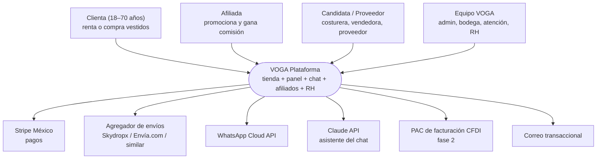
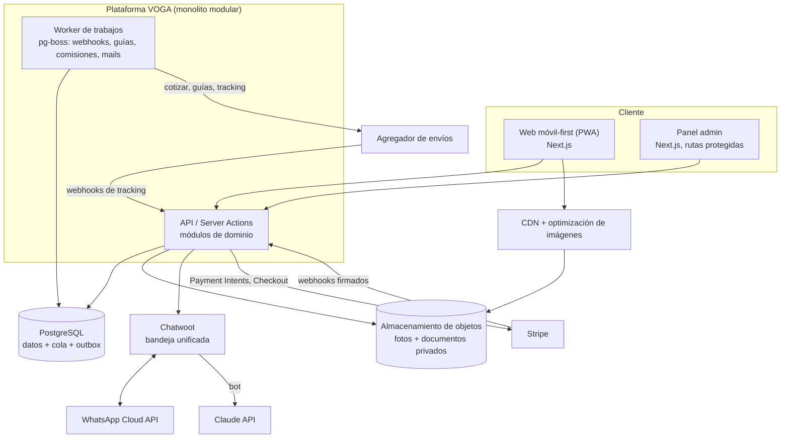
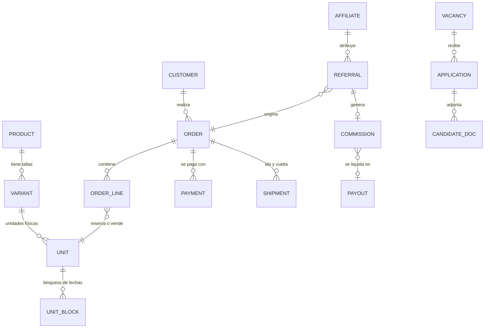
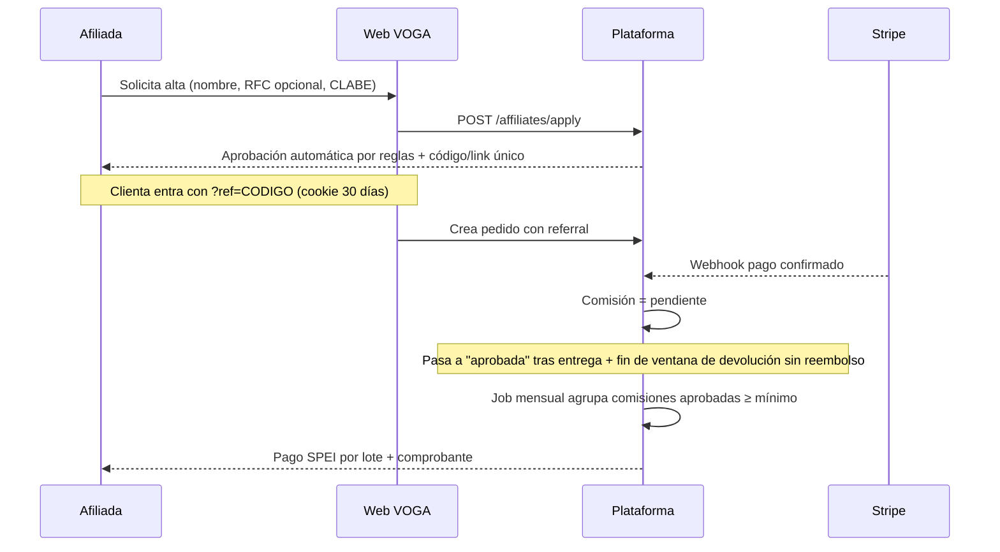

# VOGA — Renta y venta de vestidos · Arquitectura de software

> Versión 1.0 · Fecha: 2026-10-29 · Estado: propuesta para piloto
> **Convención:** `[SUPUESTO]` = dato no confirmado por el negocio. `[ESTIMACIÓN]` = cifra aproximada, sin cálculo contractual; verificar precios vigentes antes de decidir. `[VERIFICAR]` = requisito legal/fiscal/comercial que debe confirmarse con un profesional o con el proveedor.

---

## 1. Resumen y entendimiento

**Problema.** Mujeres de 18 a 70 años, segmento medio-bajo, en toda la República Mexicana, necesitan **rentar o comprar un vestido** para un evento, con **envío a domicilio y recolección** de vuelta (en renta). El negocio tiene 2 años operando y hoy quiere pasar a un sistema propio.

**Qué se construye.** Una tienda web + panel interno, primero como **piloto** (inventario y clientas acotadas) y después abierta al público:

1. Catálogo con **carrusel de fotos** por vestido (renta y venta).
2. **Carrito de compras** (renta con fechas / compra).
3. **Pagos con Stripe** adaptados a México (tarjeta, OXXO, SPEI, MSI).
4. **Envíos** con cotización automática y selección de la paquetería **más barata**, incluyendo guía de retorno.
5. **Chat** de atención (WhatsApp + web) con asistente de IA y traspaso a humana.
6. **Afiliados automatizado** (alta, link/código, atribución, comisión, pago).
7. **Recursos Humanos**: reclutamiento de proveedores, costureras, trabajadoras y expertas en venta.
8. Todo lo posible **automatizado**; Claude Code se usa para construir y mantener el software.

**Alcance (sí):** catálogo, disponibilidad por fechas, checkout, pagos, envíos ida/vuelta, flujo de lavandería/costura entre rentas, chat, afiliados, ATS-lite de RH, panel admin, facturación CFDI (fase 2).
**No-alcance (por ahora):** app móvil nativa, marketplace multi-vendedor abierto, probador virtual/IA de tallas, contabilidad completa, nómina, logística propia con flotilla, internacionalización fuera de México.

**Supuestos globales** `[SUPUESTO]`
- Equipo: 1–2 desarrolladores (o una persona de negocio + Claude Code), sin equipo de operaciones 24/7.
- Presupuesto de infraestructura del piloto: bajo (<US$200/mes).
- Piloto: ≤ 300 vestidos (unidades físicas), ≤ 500 pedidos/mes, 1 bodega/taller.
- Idioma único: español (México). Moneda: MXN.
- "Carro de Stryper" se interpreta como **checkout con Stripe**; "carro de paqueterías" como **módulo de envíos**.

### 1.1 Decisiones confirmadas por el negocio (2026-10-29)

| Tema | Decisión | Efecto en la arquitectura |
|------|----------|---------------------------|
| Envío | **Lo paga la clienta.** En renta se cobra ida y retorno `[SUPUESTO: ambos tramos a cargo de la clienta]` | Checkout muestra el envío como línea aparte con la cotización más barata; no entra en la base de comisiones de afiliadas ni en el precio del vestido |
| Inventario | **≈500 vestidos**; algunos modelos tienen **varias piezas** | Modelo `product → variant (talla) → unit (pieza física)`; la disponibilidad se calcula por unidad, y un modelo está disponible si **alguna** unidad libre cubre las fechas. 500 modelos caben holgadamente en un Postgres pequeño y en un catálogo estático/ISR |
| Depósito en garantía | **Se incluye.** Se **cobra** en el checkout y se **reembolsa** tras la inspección de devolución (no se usa retención de tarjeta, que caduca ~7 días) | Entidad `deposit` por pedido (monto configurable por vestido o categoría `[SUPUESTO]`), estados `cobrado → liberado / retenido parcial / retenido total`, reembolso automático a las 48 h de inspección sin daños `[SUPUESTO]`, y evidencia fotográfica en la inspección |
| Repositorio | Repositorio **nuevo, privado y gratuito** (plan gratuito de GitHub) | Este documento migra al repo `voga`; CI con GitHub Actions dentro del cupo gratuito |

---

## 2. Requisitos

### 2.1 Funcionales (resumen priorizado)

| ID | Requisito | Prioridad |
|----|-----------|-----------|
| F1 | Catálogo con filtros (ocasión, talla, color, precio, renta/venta) y carrusel de fotos por vestido | MVP |
| F2 | Disponibilidad por fechas de renta; evitar doble reserva | MVP |
| F3 | Carrito y checkout (renta, venta o mixto) | MVP |
| F4 | Pago: tarjeta, OXXO, SPEI, MSI; reembolsos; depósito/garantía | MVP |
| F5 | Cotizar envío en vivo, ofrecer opción más barata y generar guía ida y vuelta | MVP |
| F6 | Seguimiento de pedido y notificaciones (WhatsApp/correo) | MVP |
| F7 | Panel admin: inventario, pedidos, devoluciones, inspección, lavandería | MVP |
| F8 | Chat con IA + traspaso a persona; historial por clienta | MVP |
| F9 | Afiliados: registro, link/código, tablero, comisiones, pagos | Fase 2 |
| F10 | RH: vacantes, formulario público, pipeline de candidatas, documentos | Fase 2 |
| F11 | Facturación CFDI 4.0 | Fase 2 `[VERIFICAR]` |
| F12 | Reportes (ocupación por vestido, margen, devoluciones, CAC por afiliado) | Fase 2 |

### 2.2 Atributos de calidad medibles

| Atributo | Meta piloto | Meta crecimiento | Cómo se mide |
|----------|-------------|------------------|--------------|
| Rendimiento web | LCP < 2.5 s en móvil 4G (p75) | igual | Lighthouse CI + RUM |
| Rendimiento API | p95 < 400 ms (lectura), < 800 ms (checkout) | p95 < 300 ms | métricas APM |
| Disponibilidad | 99.5 % mensual (~3.6 h caída/mes) | 99.9 % | uptime monitor externo |
| Integridad de pagos | 0 cobros duplicados; 100 % de eventos Stripe procesados una sola vez | igual | reconciliación diaria |
| Integridad de reservas | 0 dobles reservas del mismo vestido en fechas solapadas | igual | restricción en BD + test |
| Recuperación | RPO ≤ 24 h, RTO ≤ 4 h | RPO ≤ 15 min, RTO ≤ 1 h | simulacro trimestral |
| Seguridad | 0 datos de tarjeta en nuestros sistemas (PCI SAQ-A); MFA para admins | pentest anual | checklist + auditoría |
| Accesibilidad / usabilidad | WCAG 2.1 AA, fuente base ≥ 16 px, flujo de compra ≤ 5 pasos | igual | auditoría axe + pruebas con usuarias 50+ |
| Costo | < US$200/mes fijos en piloto | < 3 % de ingresos | tablero de costos |

### 2.3 Restricciones
- Cumplimiento mexicano: **LFPDPPP** (aviso de privacidad, derechos ARCO), CFDI/SAT, términos de renta, **NOM** de venta en línea / PROFECO `[VERIFICAR]`.
- Segmento medio-bajo: mucho tráfico **móvil**, conexiones inestables, parte sin tarjeta → **OXXO/SPEI y WhatsApp** son críticos.
- Equipo pequeño: priorizar **servicios gestionados** y cero Kubernetes.

---

## 3. Dirección arquitectónica

**Recomendación: monolito modular** (un solo despliegue, módulos con fronteras claras por dominio) + **integraciones externas detrás de adaptadores** (pagos, envíos, mensajería).

| Opción | Pros | Contras | Veredicto |
|--------|------|---------|-----------|
| Monolito modular | Simple de operar, una BD con transacciones (clave para reservas y pagos), barato, rápido con Claude Code | Requiere disciplina de módulos | **Elegida** |
| Microservicios | Escala por equipo | Costo y complejidad desproporcionados para 1–2 personas | Descartada |
| Eventos puros (event sourcing) | Auditoría total | Curva alta, sin necesidad real | Descartada; se usa un **outbox** simple |
| SaaS sin código (Shopify + apps) | Muy rápido al inicio | Renta por fechas, afiliados y RH a medida son frágiles/caros; dependencia | Alternativa para validar si el piloto debe salir en días |

**Estilo de integración:** REST/JSON síncrono para el cliente; **webhooks + cola de trabajos** para Stripe, paqueterías y WhatsApp; eventos internos con patrón *outbox*.

**Stack propuesto** (justificado en la sección 11 y ADRs):
- **Next.js (TypeScript)** — tienda y panel en un solo proyecto; SSR/ISR para catálogo rápido y SEO.
- **PostgreSQL gestionado (Supabase o Neon)** — transacciones y restricciones de exclusión para fechas.
- **Cola de trabajos:** `pg-boss` sobre la misma BD (evita Redis en MVP).
- **Imágenes:** Cloudflare R2 + Cloudflare Images (o Cloudinary) para redimensionado y formato WebP/AVIF.
- **Chat:** Chatwoot (código abierto) + WhatsApp Cloud API; asistente con **Claude API**.
- **Hosting:** Vercel (web) + BD gestionada; workers en un contenedor pequeño (Railway/Fly) `[SUPUESTO]`.

---

## 4. Vistas C4

### 4.1 Nivel 1 — Contexto



### 4.2 Nivel 2 — Contenedores



---

## 5. Componentes y límites del dominio (bounded contexts)

Cada módulo es **dueño de sus tablas**; los demás solo lo consultan por su interfaz interna (nunca por JOIN directo entre esquemas).

| Contexto | Responsabilidad | Dueño de datos | Depende de |
|----------|-----------------|----------------|------------|
| **Catálogo** | Modelos, tallas, fotos, precios renta/venta | `product`, `variant`, `media` | — |
| **Inventario y Disponibilidad** | Unidades físicas, estado (disponible, rentado, lavandería, costura), bloqueos de fechas | `unit`, `unit_block`, `unit_event` | Catálogo |
| **Pedidos** | Carrito, pedido, líneas renta/venta, políticas | `cart`, `order`, `order_line` | Catálogo, Inventario |
| **Pagos** | Intención de pago, cobros, reembolsos, depósito, conciliación | `payment`, `refund`, `stripe_event` | Pedidos |
| **Envíos** | Cotización, guía ida/vuelta, tracking, incidencias | `shipment`, `shipment_event`, `carrier_quote` | Pedidos |
| **Clientas** | Perfil, direcciones, consentimientos (LFPDPPP) | `customer`, `address`, `consent` | — |
| **Atención / Chat** | Conversaciones, bot, traspaso | (Chatwoot) + `conversation_ref` | Clientas, Pedidos |
| **Afiliados** | Alta, atribución, comisiones, pagos a afiliadas | `affiliate`, `referral`, `commission`, `payout` | Pedidos, Pagos |
| **RH** | Vacantes, postulaciones, documentos, pipeline | `vacancy`, `application`, `candidate_doc` | — |
| **Identidad y Acceso** | Login, roles, MFA, auditoría | `user`, `role`, `audit_log` | — |
| **Notificaciones** | Plantillas y envío (WhatsApp/correo) | `notification` | todos (vía eventos) |

**Regla de dependencia:** Catálogo e Identidad no dependen de nadie; Pedidos orquesta; Pagos y Envíos reaccionan a eventos de Pedidos. Se protege con una *fitness function* (sección 10).

---

## 6. Datos

### 6.1 Modelo de alto nivel



### 6.2 Decisiones de datos clave

- **Modelo/talla/unidad.** Un vestido "modelo" tiene variantes (talla) y **unidades físicas** (cada prenda real, con su historial). Una venta consume la unidad; una renta la **bloquea por rango de fechas**.
- **Disponibilidad como restricción de base de datos**, no solo lógica de aplicación:

```sql
CREATE EXTENSION IF NOT EXISTS btree_gist;

CREATE TABLE unit_block (
  id          BIGSERIAL PRIMARY KEY,
  unit_id     BIGINT NOT NULL REFERENCES unit(id),
  kind        TEXT NOT NULL CHECK (kind IN ('hold','rental','cleaning','repair','sold')),
  period      DATERANGE NOT NULL,           -- incluye colchón de envío y limpieza
  expires_at  TIMESTAMPTZ,                  -- solo para 'hold' (carrito/OXXO pendiente)
  order_id    BIGINT,
  EXCLUDE USING gist (unit_id WITH =, period WITH &&)
);
```

  El rango bloqueado = `fecha_evento − días_envío − 1` hasta `fecha_evento + 1 + días_retorno + días_limpieza`. Así **es imposible** la doble reserva aunque haya concurrencia.
- **Retención de carrito (`hold`)**: 15 min para tarjeta; hasta 72 h para OXXO/SPEI (liberación automática por el worker). `[SUPUESTO]`
- **Consistencia:** transacciones ACID dentro del monolito; entre sistemas externos, **consistencia eventual** con idempotencia y reconciliación diaria contra Stripe y el agregador de envíos.
- **Caché:** el catálogo se sirve con ISR/CDN (revalidación al editar). **No** se cachea disponibilidad ni precios de checkout. Redis solo si la medición lo exige.
- **Dinero:** enteros en centavos MXN; nunca `float`.
- **Almacenamiento:** Postgres para datos; objetos (fotos públicas / documentos de RH **privados** con URLs firmadas y cifrado en reposo).
- **Retención** `[SUPUESTO]`: pedidos y facturas 5 años (obligación fiscal `[VERIFICAR]`); chats 12 meses; postulaciones no contratadas 12 meses y luego borrado; logs 30–90 días.
- **Copias de seguridad:** respaldo diario automático + PITR si el plan lo ofrece; copia semanal exportada a otro proveedor; **simulacro de restauración trimestral**.
- **Datos personales sensibles (RH):** INE/CURP/RFC solo cuando se contrata, acceso restringido a rol RH, registro de accesos.

---

## 7. Integración y APIs

### 7.1 Estilo y contratos
- **Interno:** REST/JSON versionado (`/api/v1/...`) o Server Actions para la UI; contrato descrito en **OpenAPI** y validado con **Zod**.
- **Webhooks entrantes:** Stripe, agregador de envíos, WhatsApp/Chatwoot — siempre con **verificación de firma**, respuesta rápida (2xx) y procesamiento en el worker.
- **Idempotencia:** `Idempotency-Key` en creación de pedido/pago; tabla `stripe_event(id UNIQUE)` y `shipment_event(provider_id UNIQUE)` para descartar duplicados.
- **Versionado:** `v1` estable para integraciones externas; cambios compatibles hacia atrás; el front interno puede cambiar con el despliegue.

| Endpoint (ejemplo) | Descripción |
|---|---|
| `GET /api/v1/products?occasion=&size=&from=&to=` | Catálogo con disponibilidad para fechas |
| `POST /api/v1/carts/{id}/items` | Agrega renta (con fechas) o compra; crea `hold` |
| `POST /api/v1/checkout` | Cotiza envío + crea PaymentIntent (idempotente) |
| `GET /api/v1/orders/{id}` | Estado, tracking, ventana de devolución |
| `POST /api/v1/webhooks/stripe` | Eventos de pago |
| `POST /api/v1/webhooks/shipping` | Eventos de rastreo |
| `POST /api/v1/affiliates/apply` | Solicitud de afiliada |
| `POST /api/v1/careers/{vacancyId}/apply` | Postulación pública |

### 7.2 Pagos — Stripe en México
- **Stripe Checkout / Payment Element**: el PCI queda en Stripe (alcance SAQ-A).
- Métodos relevantes para el segmento `[VERIFICAR disponibilidad y comisiones vigentes en la cuenta]`: **tarjeta (con MSI)**, **OXXO** (voucher con vencimiento), **transferencia SPEI**. Incluir efectivo/transferencia es decisivo para clientas sin tarjeta.
- Flujo asíncrono para OXXO/SPEI: pedido en `pendiente_pago` → webhook `payment_intent.succeeded` → confirma reserva.
- **Depósito en garantía:** la autorización de tarjeta de Stripe caduca en unos 7 días, menor al ciclo de renta `[VERIFICAR]`. Opciones: cobrar el depósito y reembolsarlo tras la inspección, o definir cargo por daño en términos. Se propone **cobro + reembolso** (ver sección 13).
- Reembolsos y disputas: gestionados desde el panel con trazabilidad en `audit_log`.

### 7.3 Envíos — "desde los más baratos"
- Integrar **un agregador mexicano** que cotice varias paqueterías con una sola API (p. ej. Skydropx, Envía.com, Mienvío; **elegir tras comparar tarifas y cobertura reales** `[VERIFICAR]`). Esto evita integrar Estafeta/DHL/FedEx/Paquetexpress/Redpack una por una.
- **Estrategia de costo:**
  1. Empaque **estandarizado** (bolsa/caja plegada, peso y dimensiones fijos por tipo de vestido) → cotización exacta y barata.
  2. *Rate shopping*: ordenar cotizaciones por precio y filtrar por SLA mínimo (llegar ≥ 2 días antes del evento).
  3. Cotización cacheada 10 min por (CP origen, CP destino, paquete).
  4. Opciones adicionales más baratas: **recoger en tienda / entrega local** y **retorno incluido** con guía prepagada dentro del paquete.
  5. Tarifa plana por zona como *fallback* si el agregador falla.
- **Patrón adaptador:** `ShippingProvider { quote(), createLabel(), track(), cancel() }` — cambiar de agregador no toca el dominio.
- Guía de retorno generada al despachar; recolección o entrega en punto de paquetería.

### 7.4 Chat
- **WhatsApp Cloud API** como canal principal (es donde está la clienta); **Chatwoot** como bandeja única (WhatsApp + widget web).
- **Asistente con Claude API**: responde preguntas de catálogo, tallas, estado de pedido y políticas. Reglas: herramientas de **solo lectura** más "crear ticket/pasar a humana"; **nunca** reembolsa ni cambia pedidos; no inventa disponibilidad (consulta la API); registro de conversaciones y botón "hablar con una persona".
- Plantillas de WhatsApp aprobadas por Meta para notificaciones fuera de la ventana de 24 h.

### 7.5 Afiliados automatizado

- Atribución *last-click* con cookie de 30 días `[SUPUESTO]`; comisión sobre **subtotal sin envío ni impuestos**; porcentaje configurable por afiliada/categoría (ej. 8–12 % `[SUPUESTO]`, definir con márgenes).
- **Antifraude:** no autoreferido (mismo correo/teléfono/dirección/tarjeta), tope por día, revisión manual por umbral.
- **Pago:** inicialmente **lote mensual por SPEI** con mínimo ($500 MXN `[SUPUESTO]`); Stripe Connect solo si el volumen lo justifica `[VERIFICAR]`.
- **Fiscal:** retenciones/comprobantes de pagos a afiliadas `[VERIFICAR con contador]`.

### 7.6 Recursos Humanos
- Vacantes públicas (costurera, trabajadora, experta en ventas, proveedor) con formulario móvil y carga de documentos opcional.
- Pipeline: `nueva → contactada → entrevista/prueba → oferta → contratada | descartada`; plantillas de mensajes por WhatsApp; recordatorios automáticos.
- **Proveedores:** ficha (giro, ciudad, referencias, cotizaciones) y estado; órdenes de compra sencillas en fase 3.
- Acceso solo para rol `rh`; documentos sensibles cifrados y con borrado programado.

---

## 8. Calidad operativa

### 8.1 Escalabilidad
- Piloto: una instancia web serverless + 1 worker + BD pequeña; el catálogo en CDN absorbe el tráfico de lectura.
- Primer cuello esperado: **BD** y **cotizaciones de envío** → índices, pool de conexiones, caché de cotizaciones, réplica de lectura solo si hace falta.
- Temporadas pico (graduaciones, XV años, bodas, diciembre): pruebas de carga previas; escalar plan, no arquitectura.

### 8.2 Resiliencia
| Dependencia | Timeout | Reintentos | Degradación |
|---|---|---|---|
| Stripe | 10 s | 2 con backoff (con idempotency key) | Mensaje claro; no se crea pedido sin PaymentIntent |
| Agregador de envíos | 6 s | 2 + circuit breaker | Tarifa plana por zona; guía se genera después vía job |
| WhatsApp/Chatwoot | 5 s | cola con reintentos exponenciales | Correo como respaldo |
| Claude API | 15 s | 1 | El chat pasa a humana con aviso |
| BD | pool + timeouts de consulta | — | Página de mantenimiento estática |

- Jobs con **reintentos, dead-letter** y alerta; todos idempotentes.
- Liberación automática de `hold` expirados; reconciliación diaria Stripe↔BD y agregador↔BD.

### 8.3 Seguridad
- **AuthN:** clientas con correo/WhatsApp (OTP) o Google; staff con correo + **MFA obligatorio**.
- **AuthZ:** RBAC (`admin`, `bodega`, `atencion`, `rh`, `finanzas`, `afiliada`, `clienta`) + comprobación de pertenencia del recurso (evitar IDOR); *row-level security* si se usa Supabase.
- **Secretos:** gestor de secretos de la plataforma, rotación, nunca en el repo (escaneo de secretos en CI).
- **Cifrado:** TLS 1.2+, cifrado en reposo del proveedor; campos sensibles de RH con cifrado a nivel de aplicación.
- **Amenazas principales (STRIDE resumido):**
  - Webhooks falsos → verificación de firma + idempotencia.
  - Fraude con tarjeta/contracargos → 3-D Secure, Stripe Radar, límites por pedido nuevo, verificación de identidad en rentas caras `[SUPUESTO]`.
  - Robo de cuenta de staff → MFA, auditoría, sesiones cortas.
  - Abuso del bot/prompt injection → herramientas solo lectura, validación de salidas, sin acceso a datos de otras clientas.
  - Fuga de documentos de RH → bucket privado, URL firmadas, mínimos privilegios.
  - Fraude de afiliadas → reglas antiautoreferencia y aprobación diferida.
  - Bots/scraping y spam de formularios → rate limiting + captcha (Turnstile).
- **Privacidad:** aviso de privacidad, consentimientos registrados, canal ARCO, minimización de datos `[VERIFICAR con abogado]`.

### 8.4 Observabilidad
- **Logs estructurados** con `request_id`/`order_id` (sin datos personales ni tarjetas).
- **Métricas:** latencia, errores, cola de jobs, pedidos/hora, conversión checkout, fallos de webhook, tasa de fallo de cotización.
- **Trazas:** OpenTelemetry hacia Sentry/Grafana Cloud (nivel gratuito para piloto).
- **SLOs iniciales:** checkout exitoso ≥ 99 % (excluye rechazos del banco); webhooks procesados < 1 min p95; disponibilidad 99.5 %.
- **Alertas** (al WhatsApp/correo del responsable): caída, cola atascada > 10 min, discrepancia en conciliación, pico de errores 5xx.

---

## 9. Despliegue y entrega

| Entorno | Propósito | Notas |
|---|---|---|
| `local` | Desarrollo | Docker Compose (Postgres) + Stripe CLI en modo test |
| `preview` | Por PR | Vercel preview + BD de ramas; Stripe y agregador en **modo sandbox** |
| `staging` | Pruebas previas | Datos sintéticos, igual configuración que producción |
| `prod` | Operación | Secretos separados, respaldo y alertas activas |

- **CI/CD (GitHub Actions):** lint → tipos → pruebas unitarias → pruebas de integración (Postgres efímero) → escaneo de dependencias y secretos → build → despliegue a preview/staging; producción con aprobación manual.
- **Migraciones:** versionadas (Prisma/Drizzle), patrón *expand/contract* para no romper con despliegues en vivo.
- **Release:** *feature flags* (p. ej. afiliados y RH ocultos hasta Fase 2), despliegue gradual del piloto a un grupo de clientas.
- **Rollback:** reversión de despliegue en un clic; migraciones compatibles hacia atrás; restauración de BD desde respaldo documentada en un *runbook*.
- **IaC:** Terraform solo cuando haya más de un servicio propio; en el MVP la configuración se documenta en el repo.
- **Rol de Claude Code:** `CLAUDE.md` con convenciones y límites de módulos; generación de migraciones y pruebas; revisiones automáticas de PR; *runbooks* y scripts de operación. Toda la salida pasa por CI antes de producción.

---

## 10. Estrategia de pruebas y *fitness functions*

| Nivel | Qué cubre | Herramienta |
|---|---|---|
| Unitarias | Reglas de precio, ventanas de fechas, comisiones, políticas de devolución | Vitest |
| Integración | Reservas concurrentes contra Postgres real; webhooks Stripe duplicados/fuera de orden | Vitest + Testcontainers |
| Contrato | Respuestas del agregador y de Stripe (mocks versionados); esquema OpenAPI | Pact/Zod + fixtures |
| E2E | Flujos: rentar con tarjeta, rentar con OXXO, comprar, devolución, alta de afiliada | Playwright (móvil) |
| Carga | Pico de catálogo y checkout simultáneo para el mismo vestido | k6 |
| Seguridad | Dependencias, secretos, IDOR/roles, OWASP básico | Dependabot, gitleaks, ZAP |
| Accesibilidad | WCAG AA | axe + revisión manual con usuarias reales |
| Restauración | Recuperar BD desde respaldo | simulacro trimestral |

**Fitness functions (automáticas en CI):**
1. Los módulos no se importan entre sí salvo por su interfaz pública (`dependency-cruiser`).
2. Ninguna ruta de código toca tarjetas ni guarda PAN/CVV (búsqueda estática + revisión).
3. Todo handler de webhook verifica firma y usa tabla de idempotencia (test de arquitectura).
4. La restricción `EXCLUDE` de disponibilidad existe y se prueba con 50 solicitudes concurrentes.
5. LCP y peso de página del catálogo bajo el presupuesto (Lighthouse CI).
6. Todo endpoint protegido tiene prueba de autorización negativa.

---

## 11. Costos estimados (orden de magnitud mensual) `[ESTIMACIÓN]`

> Precios de referencia aproximados en USD, **no cotizados**; verificar en cada proveedor. Los porcentajes de Stripe y las tarifas de WhatsApp/envíos dependen de la cuenta y del volumen.

| Concepto | Piloto | Crecimiento (~2,000 pedidos/mes) |
|---|---|---|
| Hosting web (Vercel Pro/similar) | 20 | 40–100 |
| BD gestionada (Supabase/Neon) | 0–25 | 25–100 |
| Worker (Railway/Fly) | 5–10 | 10–30 |
| Almacenamiento + imágenes (R2/Cloudinary) | 0–10 | 10–50 |
| Chatwoot (autoalojado o nube) | 6–19 | 19–60 |
| Claude API (chat) | 10–40 | 50–200 |
| WhatsApp (conversaciones de Meta) | variable, 0–30 | 50–300 |
| Correo transaccional | 0–15 | 15–35 |
| Monitoreo (Sentry/uptime) | 0–10 | 25–80 |
| Dominio + DNS/WAF (Cloudflare) | 2–5 | 5–20 |
| **Total fijo aproximado** | **≈ 50–190** | **≈ 250–900** |

- **Costos variables (no fijos):** comisión de Stripe (tarjeta/OXXO/SPEI, más IVA) y envíos; esto domina el costo real y debe reflejarse en precios. Si aplica, repercutir el envío al cliente o integrarlo al precio.
- **Cálculo de apoyo:** costo por pedido = comisión de pago + envío ida (+ retorno) + lavandería + merma. Con 500 pedidos/mes el costo fijo por pedido ≈ US$0.10–0.40 `[ESTIMACIÓN: total fijo ÷ pedidos]`.

**Palancas para reducir costos:**
1. Un solo proveedor para BD+auth+storage en el piloto.
2. Cache y CDN agresivo para catálogo; imágenes optimizadas (WebP/AVIF).
3. Elegir plan de agregador con mejores tarifas por volumen; empaque estandarizado.
4. Bot de IA con modelo pequeño y respuestas de FAQ en caché; escalar a humana solo si es necesario.
5. Empujar OXXO/SPEI (comisión diferente a tarjeta) o transferencia directa según margen `[VERIFICAR]`.
6. Entrega local/recolección en tienda en ciudades con operación propia.
7. Autoalojar Chatwoot y workers en un solo VPS cuando el equipo lo soporte.

---

## 12. Riesgos, deuda técnica y plan de evolución

### 12.1 Riesgos
| Riesgo | Impacto | Mitigación |
|---|---|---|
| Vestido no regresa / llega dañado | Pérdida de inventario | Depósito, inspección con fotos al salir y regresar, términos claros, seguro por envío |
| Retraso de paquetería antes del evento | Clienta pierde evento, reembolso | Colchón de envío, servicio exprés opcional, política de compensación |
| Fraude de tarjeta / contracargos | Pérdida económica | 3-D Secure, Radar, límites en cuentas nuevas, verificación de identidad |
| Dependencia de un proveedor (Stripe/agregador) | Interrupción | Patrón adaptador; plan B documentado |
| Operación manual (lavandería, costura) cuello de botella | Baja rotación | Tablero de estados y alertas en panel |
| Cumplimiento (LFPDPPP, CFDI, PROFECO) | Multas | Revisión legal/contable antes del lanzamiento público |
| Un solo desarrollador | Bus factor | Documentación, CLAUDE.md, pruebas, runbooks |

### 12.2 Deuda técnica asumida (consciente)
- Sin Redis ni microservicios; cola en Postgres.
- Facturación CFDI y Stripe Connect diferidos.
- Búsqueda con filtros SQL (sin Elasticsearch) hasta ~5,000 productos.
- Aprobación de afiliadas con reglas simples, antifraude básico.
- Un solo almacén/taller, sin multi-bodega.

### 12.3 Fases
| Fase | Alcance | Criterio de salida |
|---|---|---|
| **0 – Preparación (2–3 sem)** `[ESTIMACIÓN]` | Inventario fotografiado y capturado, políticas de renta, cuentas Stripe/agregador/WhatsApp, decisión de depósito | Catálogo de piloto listo |
| **1 – MVP piloto (6–8 sem)** `[ESTIMACIÓN]` | Catálogo+carrusel, disponibilidad, carrito, Stripe, envíos, panel básico, chat WhatsApp | 50 pedidos reales sin doble reserva ni cobro duplicado |
| **2 – Apertura web (6–8 sem)** | Afiliados automatizados, RH, CFDI, reportes, SEO, notificaciones completas | Operación nacional estable, SLO cumplidos 2 meses |
| **3 – Crecimiento** | Multi-bodega, Stripe Connect, búsqueda avanzada, recomendaciones, proveedores con órdenes de compra, app/PWA instalable | Evaluación según volumen y costos |

---

## 13. Preguntas abiertas para el negocio

1. ¿Cuántos vestidos y cuántas tallas tiene hoy? ¿Cada vestido es único o hay varias piezas del mismo modelo?
2. ¿Plazos de renta típicos (1 noche, 3 días, fin de semana)? ¿Días de colchón para envío y limpieza?
3. ~~Depósito~~ Resuelto: se cobra y se reembolsa tras inspección. Pendiente: monto por categoría y qué daños se descuentan.
4. ~~Envío~~ Resuelto: lo paga la clienta. Pendiente: confirmar si paga ambos tramos en renta.
5. ¿Ciudad(es) de la bodega y zona de entrega local? ¿Se ofrece recolección en tienda?
6. ¿Cuenta de Stripe México ya creada y verificada? ¿Qué métodos (OXXO, SPEI, MSI) están habilitados?
7. ¿Porcentaje de comisión de afiliadas, ventana de pago, monto mínimo y régimen fiscal de las afiliadas?
8. ¿Número de WhatsApp Business ya existente? ¿Quién atiende el chat y en qué horario?
9. ¿Qué tipo de contratación se busca en RH (planta, destajo, freelance)? ¿Qué documentos se piden y cuándo?
10. ¿Se requiere factura (CFDI) desde el inicio? ¿Régimen fiscal del negocio?
11. ¿Cuánto tiempo y presupuesto reales hay para el piloto? ¿Quién operará el panel día a día?
12. ¿Políticas de devolución para ventas (cambios por talla, plazos)?

---

## 14. Tabla de decisiones

| Decisión | Alternativas | Elección | Motivo | Consecuencias |
|---|---|---|---|---|
| Estilo arquitectónico | Microservicios, serverless puro, SaaS | **Monolito modular** | Simplicidad, transacciones, costo | Requiere disciplina de módulos y fitness functions |
| Frontend/Backend | Laravel, Django, Rails | **Next.js + TypeScript** | Un solo lenguaje, SSR/SEO, buen soporte con Claude Code | Acoplamiento a ecosistema JS |
| Base de datos | MySQL, MongoDB, Airtable | **PostgreSQL** | Restricciones de exclusión para fechas, JSON, madurez | Hay que dominar SQL/migraciones |
| Disponibilidad | Lógica en app, bloqueo con Redis | **`EXCLUDE USING gist` + holds con expiración** | Imposible la doble reserva incluso con concurrencia | Reglas de colchón en la capa de dominio |
| Cola de trabajos | Redis/BullMQ, SQS | **pg-boss (Postgres)** | Un servicio menos | Límite de throughput; migrable |
| Pagos | Mercado Pago, Conekta, Openpay | **Stripe (con adaptador)** | Requerido por el negocio; PCI delegado; OXXO/SPEI/MSI | Comisión variable; dependencia mitigada con adaptador |
| Envíos | Integrar cada paquetería | **Agregador + adaptador** | Mejor precio comparado, una integración | Dependencia del agregador; plan B por zona |
| Chat | Widget propio, solo WhatsApp manual | **Chatwoot + WhatsApp Cloud + Claude** | Canal real de la clienta, bandeja unificada, IA con límites | Costos por conversación; plantillas Meta |
| Afiliados | Plataforma externa de afiliados | **Módulo propio** | Control, bajo costo, datos | Hay que mantener antifraude y pagos |
| Imágenes | Servir originales | **CDN + optimización + carrusel accesible** | LCP y datos móviles | Costo mínimo de transformación |
| Hosting | VPS propio, Kubernetes | **PaaS gestionado** | Poca operación | Menor control; migrable |
| Autenticación | Propia | **Proveedor gestionado + OTP WhatsApp** | Seguridad y rapidez | Dependencia del proveedor |

---

## 15. ADRs

### ADR-001 — Monolito modular como estilo base
- **Estado:** Aceptado
- **Contexto:** Equipo de 1–2 personas, presupuesto bajo, necesidad de transacciones entre pedido, pago y reserva, y de salir rápido con Claude Code.
- **Decisión:** Un único despliegue (Next.js + worker) con módulos por contexto delimitado (sección 5), una BD PostgreSQL y reglas de dependencia verificadas en CI. Integraciones externas detrás de interfaces (puertos/adaptadores).
- **Consecuencias:** (+) operación simple, bajo costo, consistencia fuerte. (–) escalado por componente limitado; si algún módulo (p. ej. envíos o chat) crece, puede extraerse porque ya tiene frontera clara. Se requiere disciplina para no filtrar acoplamientos.

### ADR-002 — Disponibilidad de vestidos garantizada en PostgreSQL
- **Estado:** Aceptado
- **Contexto:** El error más costoso del negocio es rentar dos veces el mismo vestido para fechas solapadas; hay concurrencia, pagos diferidos (OXXO/SPEI) y colchones de envío/limpieza.
- **Decisión:** Modelar `unit_block` con `DATERANGE` y `EXCLUDE USING gist (unit_id WITH =, period WITH &&)`. Los carritos crean `hold` con `expires_at`; el pago confirmado lo convierte en `rental`. El rango incluye colchón de envío, retorno y limpieza.
- **Consecuencias:** (+) invariantes garantizados por la BD, pruebas de concurrencia sencillas. (–) dependencia de funciones específicas de PostgreSQL (portabilidad menor); hay que limpiar `hold` expirados con un job y comunicar bien al usuario cuando una fecha deja de estar disponible.

### ADR-003 — Pagos y envíos mediante adaptadores idempotentes con Stripe y un agregador
- **Estado:** Aceptado
- **Contexto:** El negocio exige Stripe y paqueterías "desde las más baratas"; el mercado mexicano usa OXXO/SPEI (asíncronos) y múltiples paqueterías; los proveedores fallan y envían webhooks duplicados o desordenados.
- **Decisión:** Interfaces `PaymentProvider` y `ShippingProvider` implementadas con Stripe y un agregador de envíos. Webhooks con verificación de firma, tabla de eventos únicos y procesamiento en el worker. Cotización con *rate shopping* y caché corta; tarifa plana por zona como *fallback*. Conciliación diaria con ambos proveedores.
- **Consecuencias:** (+) se puede cambiar de proveedor, resistencia a duplicados y caídas, menor costo de envío. (–) mayor código de integración inicial y necesidad de monitorear conciliaciones; se acepta dependencia temporal del agregador elegido.

---

## 16. Checklist de revisión

**Calidad**
- [x] Requisitos funcionales y atributos medibles definidos
- [x] Estilo arquitectónico justificado con alternativas
- [x] Modelo de datos y restricciones de dominio (disponibilidad)
- [ ] Prototipo de UX del carrusel y flujo de compra validado con usuarias 50+
- [ ] Contratos OpenAPI redactados
- [ ] Políticas de renta/devolución definidas por el negocio

**Seguridad**
- [x] PCI delegado a Stripe (SAQ-A)
- [x] AuthN/AuthZ, MFA para staff, manejo de secretos
- [x] Amenazas principales y mitigaciones
- [ ] Aviso de privacidad y consentimientos revisados por abogado
- [ ] Pentest básico previo al lanzamiento público
- [ ] Política de retención y borrado de datos de RH aprobada

**Operación**
- [x] Entornos, CI/CD, rollback y migraciones
- [x] Observabilidad: logs, métricas, trazas, SLOs, alertas
- [x] Estrategia de respaldos y RPO/RTO
- [ ] Runbooks (caída de Stripe, caída de agregador, webhook atascado, restauración)
- [ ] Simulacro de restauración ejecutado
- [ ] Cuentas y sandbox de Stripe/agregador/WhatsApp creadas

**Coste**
- [x] Estimación mensual y palancas
- [ ] Cotización real de agregador de envíos y comisiones de Stripe
- [ ] Modelo de margen por pedido (comisión + envío + lavandería + merma)
- [ ] Presupuesto de Claude API y WhatsApp con tope mensual

**Fiscal / legal**
- [ ] CFDI 4.0 y régimen fiscal confirmados con contador
- [ ] Tratamiento fiscal de comisiones a afiliadas
- [ ] Términos y condiciones de renta (daños, pérdida, retraso) revisados por abogado
